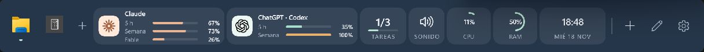
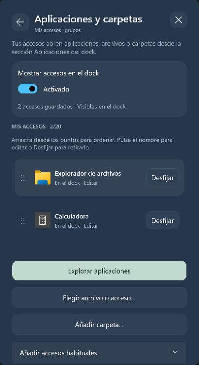
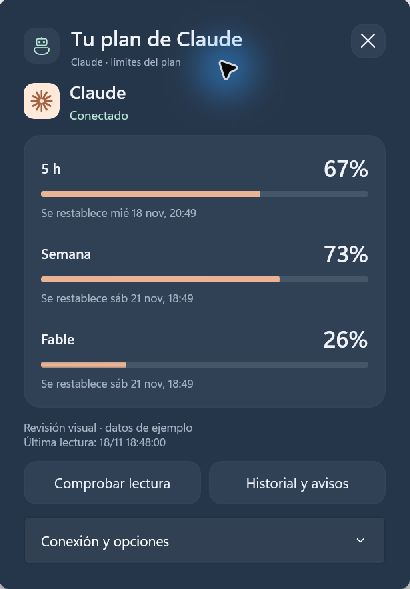
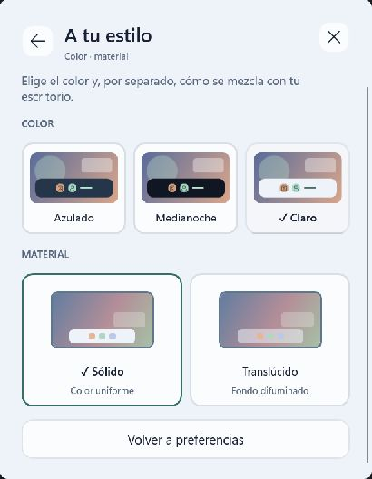

# Brisa Dock

A customizable Windows dock for your apps, shortcuts and everyday tools, built with C# and WinUI 3.



**Your apps, tools and usage limits, close at hand.** Arrange the dock visually and choose the color and material that fit your desktop.

<details>
<summary>See the light theme</summary>


</details>

## A closer look

<p>
  
  
  
</p>

Real application screenshots with **sample data**, not live account information. The application currently uses Spanish UI text; source identifiers, comments, file names and repository documentation use English.

**Status:** public preview, **0.17.6**. Download the installer from [GitHub Releases](https://github.com/danieljcorreac/brisa-dock/releases/latest), report issues or propose changes through a pull request.

## Features

- Apps and folders with native icons, search, groups and drag-and-drop ordering.
- Preferred monitor, top/bottom placement, sizing, spacing and auto-hide.
- Blue, midnight and light colors; solid/translucent materials and reduced motion.
- Existing tools for tasks, notes, local calendars, timers, audio and system metrics.
- Claude Desktop/Claude Code usage and ChatGPT plan limits returned by Codex.
- Reviewable backups, settings recovery, local updates and version rollback.
- Notification-area integration, keyboard navigation and accessibility preferences.
- Daily stable-release checking, verified GitHub downloads and review before updating. Updates use anonymous HTTPS, without a GitHub account, token or GitHub CLI.

ChatGPT usage means **Codex plan limits**, not chat message counts or API spending. External integrations may change. See [connections and privacy](docs/AI.md).

## Requirements and installation

The verified target is **Windows 11 x64**. Other architectures and Windows 10 are not presented as supported or tested.

Once a Release is published, download `Brisa-Setup-<version>-win-x64.exe` or the matching ZIP. Both include their runtimes. The installer works per user; the ZIP provides `Install-Brisa.cmd` and a `maintenance/` directory.

Packages do not carry a commercial code-signing certificate. SHA-256 checks integrity against an expected hash; it does not authenticate the publisher. Do not disable Windows protections to run a package.

No Release files have been published yet. To prepare them locally:

```powershell
pwsh -File scripts/New-ReleasePackage.ps1
```

## Development

Use Windows, PowerShell 7 and the .NET SDK in [global.json](global.json), with the Windows development tools required by WinUI. Open `Brisa.slnx` or use:

```powershell
dotnet run --project tests/Brisa.Checks -c Release
pwsh -File scripts/Build-Brisa.ps1
pwsh -File scripts/Start-Brisa.ps1 -Review
```

Review mode opens `artifacts/build/BrisaDock.exe` with isolated sample data and no account connections. See [contributing](CONTRIBUTING.md), [architecture](docs/ARCHITECTURE.md) and [verification](docs/TESTING.md).

## Repository layout

| Directory | Purpose |
| --- | --- |
| `src/` | Maintained application, Core library and Claude Code bridge |
| `tools/` | Self-contained setup bootstrapper |
| `scripts/` | Build, package, start and publication checks |
| `scripts/deployment/` | Installer, update, rollback and uninstall sources |
| `tests/` | Core and isolated deployment checks |
| `docs/` | Architecture, guides, roadmap and screenshots |
| `artifacts/` | Generated builds and release packages; ignored by Git |
| `local/app/` | Optional personal installation and private data; ignored by Git |
| `qa/` | Local verification evidence; ignored by Git |

The repository has no `dist` or version-suffixed distribution directories. Generated builds and the personal installation have separate homes. See the [layout guide](docs/LAYOUT.md) for details.

## Use and local data

The gear opens preferences, `+` manages the existing widget collection and the pencil enables dock ordering. Shortcut rows support dragging, editing and unpinning. Back arrows navigate within panels; Escape closes them.

Application data lives in `data/` inside its installation. Never attach it to issues or PRs. Backups can include private notes, tasks and paths: review them before sharing.

## Contribute

`main` is stable; `develop` integrates the next version and is the usual PR target. See the [contribution guide](CONTRIBUTING.md), [changelog](CHANGELOG.md), [security policy](SECURITY.md) and [roadmap](docs/ROADMAP.md).

## License

Original code is licensed under [MIT](LICENSE). Dependencies and trademarks retain their own terms; see [third-party notices](THIRD_PARTY_NOTICES.md). Brisa is independent of the services it integrates.
